# Visual Studio shell — an evidence-based clone

**A working, local recreation of the Visual Studio 2026 shell** — Electron + React + Monaco on
the front, a small Express backend on `127.0.0.1`, and a real filesystem, real `dotnet` and real
`git` underneath.

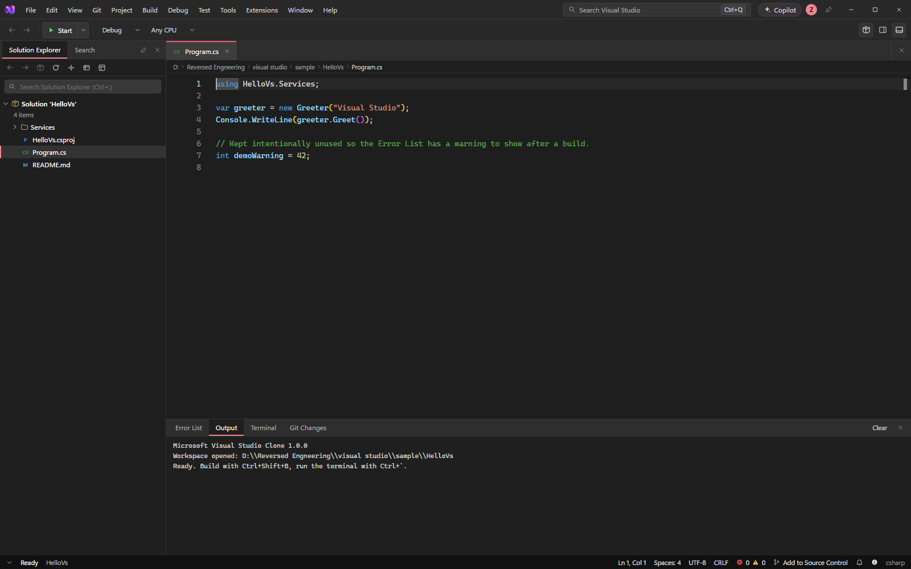

<p align="center">
  
  
  
  
  
  
</p>

> **Independent engineering study.** Not affiliated with, endorsed by, or sponsored by Microsoft.
> Visual Studio and its icon are Microsoft trademarks. See [Disclaimer](#disclaimer).

---

## Contents

- [Screenshots](#screenshots)
- [Features](#features)
- [Tech stack](#tech-stack)
- [Requirements](#requirements)
- [Quick start](#quick-start)
- [Using the app](#using-the-app)
- [Keyboard shortcuts](#keyboard-shortcuts)
- [Architecture](#architecture)
- [Project structure](#project-structure)
- [API reference](#api-reference)
- [npm scripts](#npm-scripts)
- [Packaging & distribution](#packaging--distribution)
- [Environment variables](#environment-variables)
- [Testing](#testing)
- [Provenance](#provenance)
- [Limitations](#limitations)
- [Disclaimer](#disclaimer)

---

## Screenshots

All screenshots are **1400 × 900**, captured from the running app with Puppeteer and Microsoft
Edge (`tools/ui-smoke.mjs`, `tools/ui-light.mjs`). The originals live in `evidence/screens/`.

| | |
| --- | --- |
| 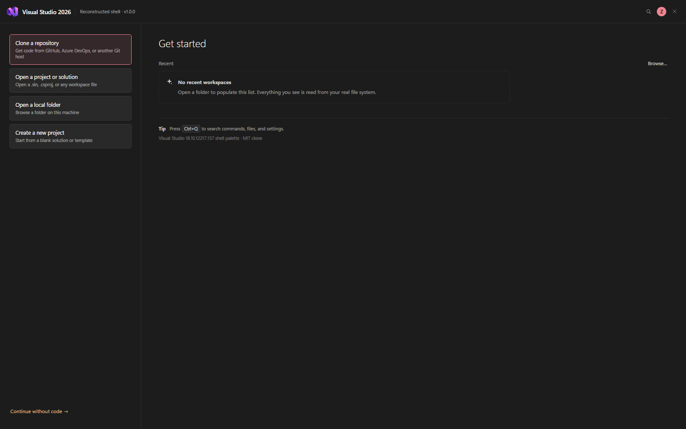<br>**Start window** — clone, open a project/solution, open a folder, create a project, recent workspaces | 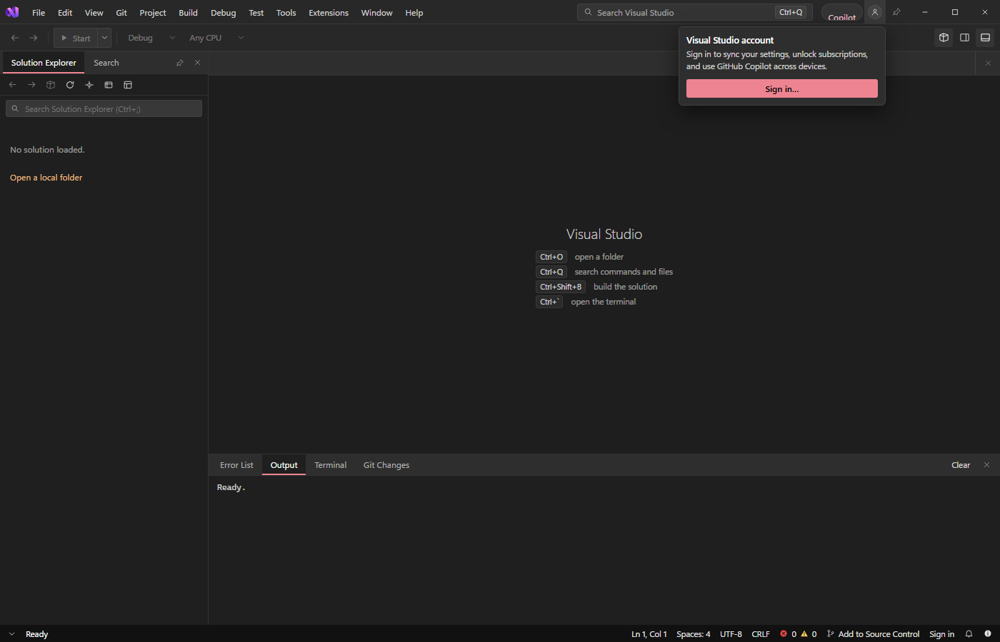<br>**Account flyout** — title-bar avatar, GitHub sign-in entry point |
| 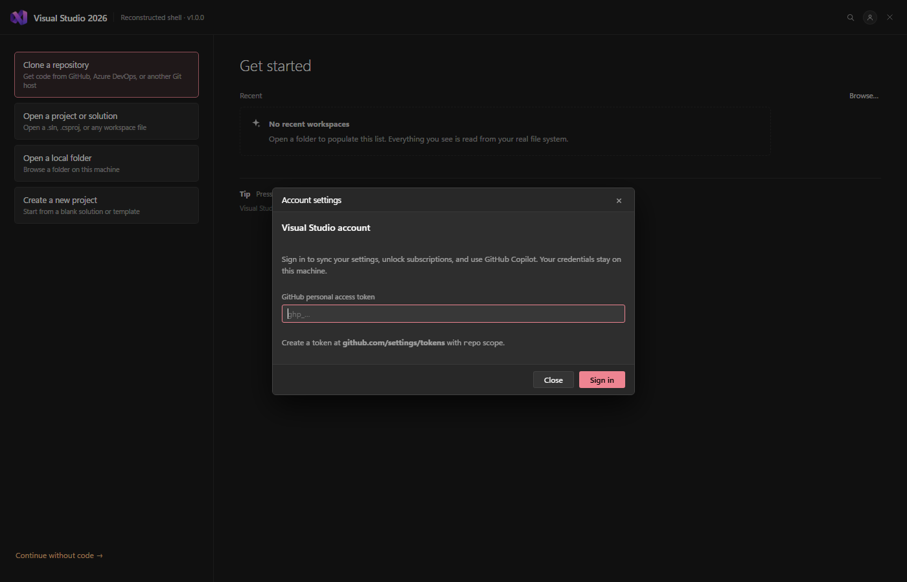<br>**Account settings** — personal access token, validated server-side | 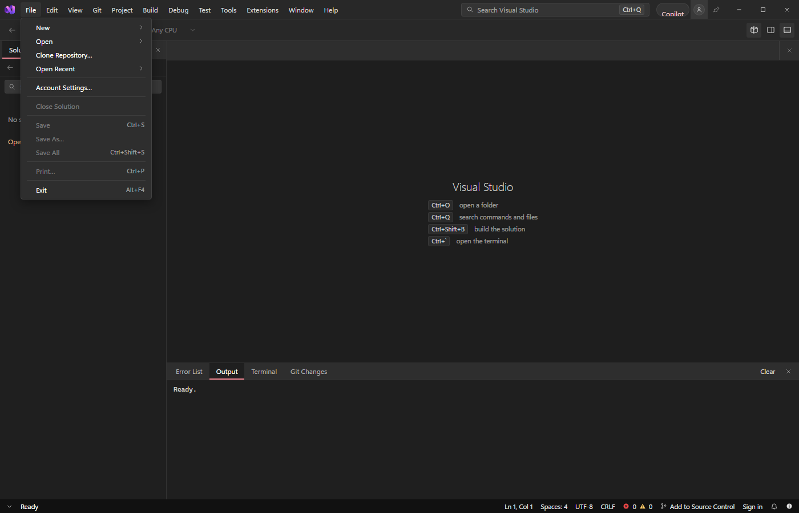<br>**File menu** — New/Open/Clone, Account Settings, Save, Save As, Save All |
| <br>**Editor** — Monaco, pinned/preview tabs, dirty markers, breadcrumbs | 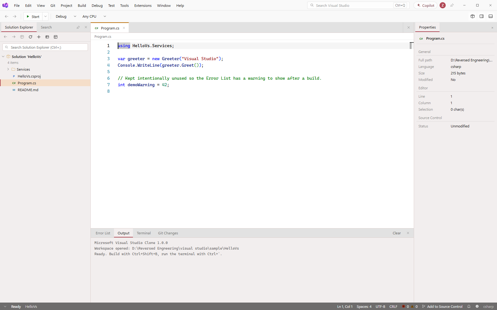<br>**Light theme** — Properties panel, decoded VS Light palette |
| 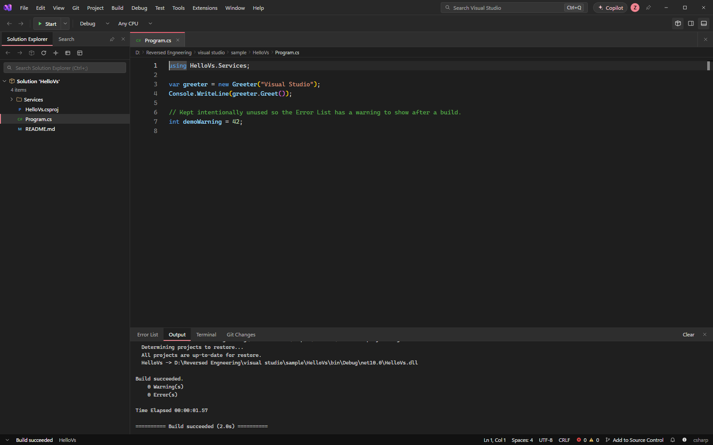<br>**Build errors** — real `dotnet build` diagnostics, double-click to navigate | 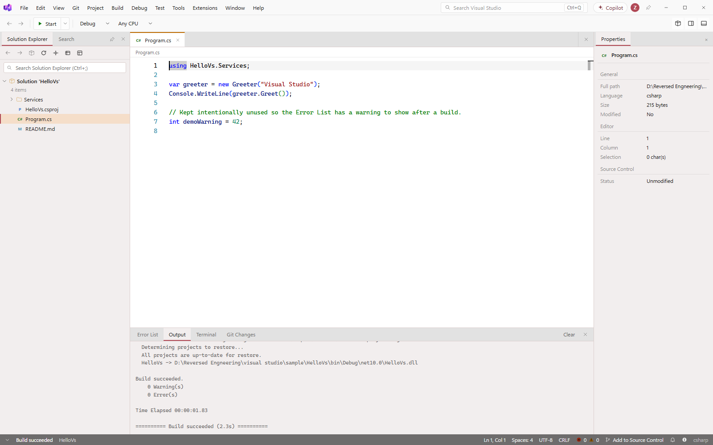<br>**Error List (light)** — severity, code, file, line |
| 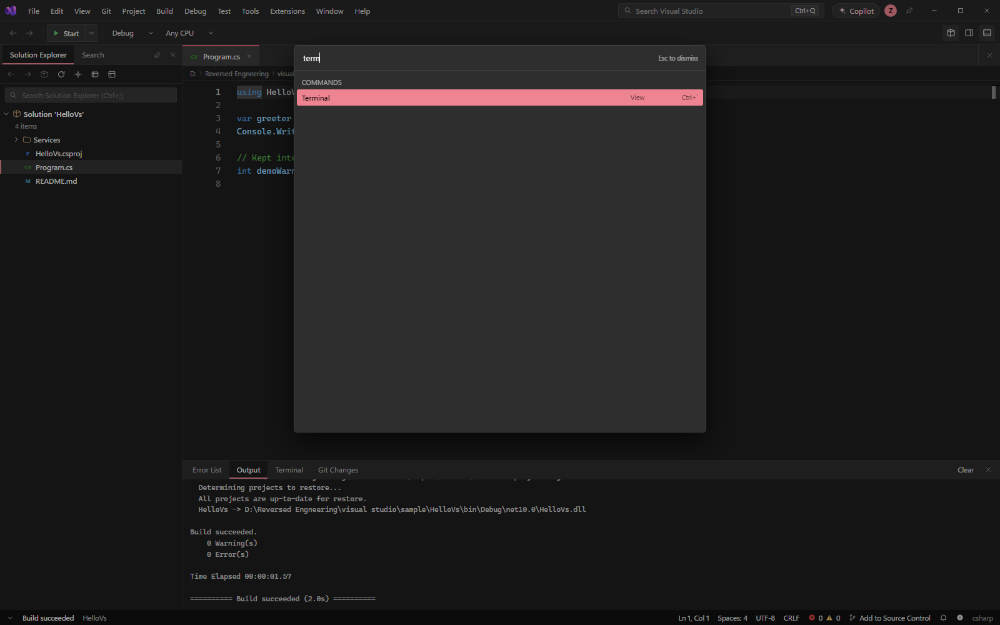<br>**Command palette** — every enabled menu command plus workspace files | 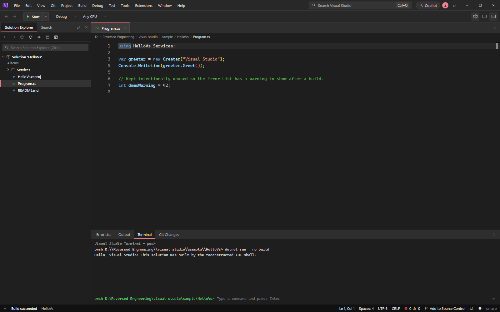<br>**Terminal** — PowerShell (Windows) / `$SHELL` (Linux), cwd tracking, history |
| 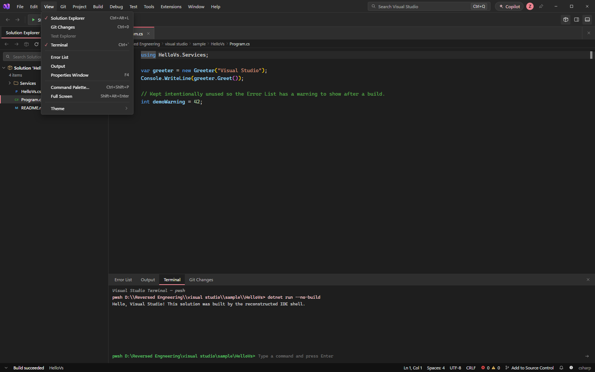<br>**Menus** — File / Edit / View / Git / Project / Build / Debug / Test / Tools / Extensions / Window / Help | 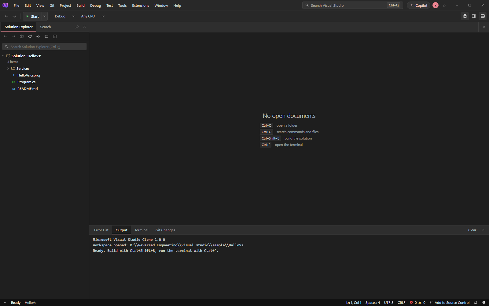<br>**Empty shell** — no folder loaded, bottom panel ready |

> The chrome palette, tab colours, surface ramp and accent are not eyeballed — they were decoded
> from the Visual Studio 18.10 theme packages on the build machine (see [Provenance](#provenance)).

---

## Features

### Shell chrome

- **Title bar** with app icon, product title, quick search (`Ctrl+Q`), Copilot button, account
  avatar and window controls.
- **Full menu model** (`src/components/MenuBar.tsx`): File, Edit, View, Git, Project, Build, Debug,
  Test, Tools, Extensions, Window, Help — including submenus, shortcuts, checkmarks and
  disabled states.
- **Toolbar** with Start/debug target, solution configuration (Debug/Release), solution platform
  (Any CPU) and panel dock toggles.
- **Document well** with preview vs. pinned tabs, modified dots, close buttons and breadcrumbs.
- **Status bar** with ready state, `Ln`/`Col`, indentation, encoding/line endings, error and
  warning counts, current branch, source-control action, account state and notifications.

### Start window

- Clone a repository, open a project/solution, open a local folder, or create a new project.
- Recent workspaces are persisted in `localStorage` and shown with their paths.
- The start window shares the account state with the title bar.

### Solution Explorer

- Lazy directory tree over a **real folder on disk**.
- File-type icons and badges (C#, JSON, Markdown, shell, images, project files).
- Filter box, refresh, collapse-all, and open-parent-folder actions.
- Single click opens a **preview tab**; double click pins the tab.
- Git status markers are reflected in the tree.

### Editor

- Monaco with a **Visual Studio-derived theme** for both dark and light modes.
- Language mapping by extension (C#, TypeScript/JavaScript, JSON, HTML/CSS, Markdown, shell,
  XML, YAML and more).
- Tabs, dirty state, Save (`Ctrl+S`), Save All (`Ctrl+Shift+S`), Save As, close (`Ctrl+W`).
- Go to line (`Ctrl+G`), breadcrumbs, find/replace from Monaco, word wrap and minimap from
  the View menu.
- Files larger than 4 MB are rejected by the API to keep the renderer responsive.

### Build & diagnostics

- Auto-detects the build system at the workspace root:
  - `*.sln` / `*.slnx` → `dotnet build <solution>`
  - `*.csproj` / `*.fsproj` / `*.vbproj` → `dotnet build <project>`
  - `package.json` with a `build` script → `npm run build`
  - one-level-deep solution folders are also found
- **Rebuild Solution** maps to MSBuild's `-t:Rebuild` target.
- MSBuild diagnostics are parsed (`file(line,col): error CSxxxx: message`) and de-duplicated into
  the **Error List** with severity, code, file, line and column.
- Clicking a diagnostic opens the file at the exact position.
- Build output, timing and exit code go to the **Output** panel; error/warning counts appear in
  the status bar.

### Integrated terminal

- Runs through `POST /api/exec` — PowerShell on Windows, `$SHELL` (fallback `/bin/sh`) on Linux
  and macOS.
- **Working-directory tracking**: `cd` changes the directory for the next command via a
  `__REA_CWD__` marker in the output.
- Command history with `↑` / `↓`, a Clear action, and <kbd>Ctrl</kbd>+<kbd>`</kbd> to toggle the panel.
- Not a PTY: interactive prompts and full-screen TUI applications are out of scope.

### Search

- `Ctrl+Shift+F` switches the left panel to **Search**.
- Real recursive content search on the backend, with case-sensitivity and whole-word options.
- Skips `node_modules`, `.git`, `.vs`, `bin`, `obj`, `dist`, `.next`, `target`, `.venv`,
  `__pycache__` and binary files; caps results to keep the UI fast.

### Source control & GitHub

- Branch name and change list from `git status --porcelain=v1 -b`.
- File status badges in Solution Explorer.
- Create repository, commit, push and clone from the **Git** menu.
- Git commands shell out to the system `git` binary, so credentials come from your normal Git
  credential helper.
- **Account sign-in** in the title bar, start window, status bar and `File ▸ Account Settings…`:
  a GitHub personal access token is validated against `https://api.github.com/user`, then the
  login, display name and avatar are shown. The token is stored locally in
  `localStorage["vsclone.github"]` and can be removed with **Sign out**.

### NuGet, references, tests and extensions

- **Manage NuGet Packages** dialog: search `nuget.org`, install with `dotnet add package`, list
  with `dotnet list package`, remove with `dotnet remove package`.
- **Add Reference** dialog: add project references with `dotnet add reference`.
- **Test ▸ Run All Tests** executes `dotnet test` on the detected solution/project and streams
  the result to Output.
- **Extensions** dialog: searches the Visual Studio Marketplace API, downloads `.vsix` packages
  into `%LOCALAPPDATA%\VisualStudioClone\extensions` (or
  `~/VisualStudioClone/extensions` on Linux/macOS), and lists/removes installed packages.
- **Copilot Chat** dialog: a chat UI that proxies to any OpenAI-compatible endpoint when
  `COPILOT_API_KEY` / `OPENAI_API_KEY` is configured; otherwise it reports that the backend is
  not configured.
- **Prerequisites** dialog reports the detected `dotnet`, `git` and Node versions.

### Theming

- **Dark** and **Light** themes built from the decoded VS theme packages.
- Monaco theme, panel surfaces, borders, accent, status bar and menu colours all come from the
  same palette.
- Theme choice is persisted across launches.

---

## Tech stack

| Layer | Technology |
| --- | --- |
| Desktop shell | Electron 45 (`electron/main.cjs`) |
| UI | React 19, TypeScript 5.7, Zustand 5 |
| Editor | Monaco Editor 0.52 (`@monaco-editor/react`) |
| Build tool | Vite 6, `tsc -b` |
| Backend | Node.js + Express 4 on `127.0.0.1:5179` |
| Toolchain integration | `dotnet`, `git`, `npm`, PowerShell / `$SHELL` |
| Packaging | electron-packager, electron-builder (NSIS, AppImage, deb) |
| UI verification | Puppeteer + Microsoft Edge |

The renderer never touches the filesystem directly: every disk, build, git, NuGet or network
operation goes through the local REST API.

---

## Requirements

- **Node.js 20+** and npm (22 LTS recommended; Electron 45 is used for the desktop build).
- **Windows 10/11** for the packaged Windows builds (PowerShell is the default terminal shell).
- **Linux x64** for the packaged Linux build (X11 or Wayland desktop session).
- Optional, for the features that delegate to real tools:
  - [.NET SDK](https://dotnet.microsoft.com/) — build, run, test, NuGet, references.
  - `git` — source control and clone.
  - A browser for development (`npm start` opens your default browser).
- Internet access for NuGet search, Marketplace search, GitHub sign-in and Copilot.

No global npm packages are required; everything is local to the project.

---

## Quick start

```powershell
git clone https://github.com/mzainulabideendev/visual-studio.git
cd visual-studio
npm install
npm start
```

`npm start` runs `dev.mjs`, which:

1. starts the API server on **http://127.0.0.1:5179**,
2. starts Vite on **http://localhost:5180** (with `/api` proxied to the backend),
3. opens the UI in your default browser.

Then choose **File ▸ Open ▸ Folder…** and pick any folder, or start with the bundled sample:

```text
sample/HelloVs/
```

### Production build

```powershell
npm run build      # tsc -b + vite build → dist/
npm run preview    # Express serves dist/ and the API from :5179
```

### Desktop app from source

```powershell
npm run build
npm run electron
```

---

## Using the app

1. **Open a workspace** — start window *Open a local folder*, or `File ▸ Open ▸ Folder…`.
2. **Browse and edit** — click files in Solution Explorer; edit in Monaco; `Ctrl+S` saves.
   Dirty tabs show a dot; preview tabs are replaced until you double-click to pin them.
3. **Search** — `Ctrl+Shift+F`, type a query, click a result to open it at the match.
4. **Build** — `Ctrl+Shift+B` or `Build ▸ Build Solution`. Errors land in the Error List;
   double-click one to jump to the line.
5. **Run** — `F5` (or `Debug ▸ Start`) runs `dotnet run --project <project>` and prints the
   output and exit code in Output.
6. **Terminal** — press <kbd>Ctrl</kbd>+<kbd>`</kbd> and run any shell command; `cd` is tracked
   between commands.
7. **Git** — open **Git Changes**, create a repository, commit, or push.
8. **Account** — click the avatar in the title bar, or `File ▸ Account Settings…`, and paste a
   GitHub token to show your identity.
9. **Command palette** — `Ctrl+Q` / `Ctrl+Shift+P` to run any enabled command or open a file.

---

## Keyboard shortcuts

| Shortcut | Action |
| --- | --- |
| `Ctrl+Q` / `Ctrl+Shift+P` | Command palette (commands + files) |
| `Ctrl+O` | Open project / solution dialog |
| `Ctrl+Shift+O` | Open project / solution dialog (menu alias) |
| `Ctrl+N` | New file |
| `Ctrl+Shift+N` | New project |
| `Ctrl+S` | Save |
| `Ctrl+Shift+S` | Save all |
| `Ctrl+W` | Close active document |
| <kbd>Ctrl</kbd>+<kbd>`</kbd> | Toggle terminal |
| `Ctrl+Shift+B` | Build solution |
| `F5` | Run project (`dotnet run --project`) |
| `Ctrl+Shift+F` | Workspace search |
| `Ctrl+G` | Go to line |
| `F4` | Toggle Properties panel |
| `Esc` | Close dialog / palette |
| `Alt+F4` | Exit (menu label) |

Standard Monaco bindings (`Ctrl+F`, `Ctrl+H`, `Ctrl+/`, `Alt+↑/↓`, …) work inside the editor.

---

## Architecture

```text
┌────────────────────────────────────────────────────────────────────┐
│ Electron main process — electron/main.cjs                          │
│  • spawns server/index.mjs with ELECTRON_RUN_AS_NODE=1             │
│  • waits for /api/info, then opens the BrowserWindow               │
│  • loads http://127.0.0.1:5179/ (production)                       │
└───────────────────────────────┬────────────────────────────────────┘
                                │ HTTP
┌───────────────────────────────▼────────────────────────────────────┐
│ Express backend — server/index.mjs                                 │
│  • REST API on 127.0.0.1:5179                                      │
│  • serves dist/ in production (NODE_ENV=production or --serve)     │
│  • filesystem, search, exec, build, git, NuGet, Marketplace, tests │
└───────────────────────────────┬────────────────────────────────────┘
                                │ child processes
        ┌───────────────────────┼────────────────────────┐
        ▼                       ▼                        ▼
   dotnet CLI               git CLI              PowerShell / $SHELL
```

**Development** — Vite serves the React app on `:5180` and proxies `/api` to `:5179`.
**Production/Electron** — the backend serves the built frontend and the window points at
`:5179`, so no Vite server is required.

State lives in a single Zustand store (`src/store.ts`); the API client is `src/lib/api.ts`.
The Electron main process only manages the backend lifecycle, the window and the menu-less
shell; all UI is web technology.

---

## Project structure

```text
.
├─ electron/
│  └─ main.cjs                Electron main process (server lifecycle + window)
├─ server/
│  └─ index.mjs               Express API: files, search, exec, build, git, NuGet, extensions
├─ src/
│  ├─ App.tsx                 layout, global shortcuts, start window switch
│  ├─ store.ts                Zustand state: workspace, docs, build, git, terminal, auth
│  ├─ theme.ts                decoded palette + Monaco themes
│  ├─ styles.css              shell styling
│  ├─ components/
│  │  ├─ TitleBar.tsx         product title, search, Copilot, account, window buttons
│  │  ├─ MenuBar.tsx          complete menu model and submenus
│  │  ├─ Toolbar.tsx          Start, configurations, dock toggles
│  │  ├─ SolutionExplorer.tsx tree, filter, search view
│  │  ├─ EditorPane.tsx       tabs, breadcrumbs, Monaco host
│  │  ├─ BottomPanel.tsx      Error List, Output, Terminal, Git Changes
│  │  ├─ StatusBar.tsx        diagnostics, Ln/Col, branch, account
│  │  ├─ CommandPalette.tsx   commands + workspace files
│  │  ├─ StartWindow.tsx      start page, recents, account
│  │  ├─ Dialogs.tsx          open/new/NuGet/account/Copilot/clone/extensions/about
│  │  └─ Icons.tsx            inline SVG icon set
│  └─ lib/                    API client, editor bus, language map, platform helpers
├─ public/                    app icon (PNG/ICO/512)
├─ tools/                     packaging, installer, icon/theme extraction, smoke tests
├─ installer/                 Visual Studio-style setup UI (source; payload is generated)
├─ sample/HelloVs/            small .NET console app for a first build
├─ evidence/                  decoded theme JSON, icon resources, screenshots
├─ docs/PROVENANCE.md         how the visuals were recovered
├─ .github/workflows/linux.yml  Ubuntu CI: AppImage + deb + portable tar.gz
└─ package.json               scripts, dependencies, electron-builder config
```

---

## API reference

All endpoints are served by the local Express backend and are only reachable from the machine
(`127.0.0.1`). Bodies are JSON unless noted.

### Workspace and files

| Method | Endpoint | Purpose |
| --- | --- | --- |
| `GET` | `/api/info` | Product version, platform, home directory, drive/root list |
| `GET` | `/api/list?dir=…` | Directory listing with types and metadata |
| `GET` | `/api/read?path=…` | Read a text file (4 MB limit, binary detection) |
| `POST` | `/api/write` | Save file contents |
| `POST` | `/api/create` | Create a file or directory |
| `POST` | `/api/remove` | Delete a file or directory |
| `POST` | `/api/rename` | Rename / move |
| `POST` | `/api/search` | Recursive content search |
| `POST` | `/api/new-project` | Create a .NET project/solution skeleton |

### Build, run, terminal

| Method | Endpoint | Purpose |
| --- | --- | --- |
| `POST` | `/api/build` | Detect and run `dotnet build` / `npm run build`; parse diagnostics |
| `POST` | `/api/run` | Run `dotnet run --project …` |
| `POST` | `/api/test` | Run `dotnet test` |
| `POST` | `/api/clean` | Clean build outputs |
| `POST` | `/api/exec` | Execute a shell command with cwd tracking |

### Source control

| Method | Endpoint | Purpose |
| --- | --- | --- |
| `GET` | `/api/git` | Branch and porcelain status |
| `POST` | `/api/git/init` | `git init` |
| `POST` | `/api/git/commit` | Stage all and commit |
| `POST` | `/api/git/push` | `git push` |
| `POST` | `/api/git/clone` | Clone a repository |
| `POST` | `/api/auth/github` | Validate a GitHub token and return the profile |

### Packages, extensions, environment

| Method | Endpoint | Purpose |
| --- | --- | --- |
| `POST` | `/api/nuget` | Add a NuGet package |
| `POST` | `/api/nuget/list` | List installed packages |
| `POST` | `/api/nuget/remove` | Remove a package |
| `POST` | `/api/nuget/search` | Search nuget.org |
| `POST` | `/api/refs/list` | List project/assembly references |
| `POST` | `/api/refs/add` | Add a reference |
| `POST` | `/api/copilot` | Proxy a chat completion to an OpenAI-compatible endpoint |
| `GET` | `/api/prereq` | Detect `dotnet`, `git`, Node versions |
| `GET` | `/api/extensions` | List installed extensions |
| `POST` | `/api/extensions/search` | Search the Visual Studio Marketplace |
| `POST` | `/api/extensions/install` | Download/install a `.vsix` |
| `POST` | `/api/extensions/remove` | Remove an installed extension |

---

## npm scripts

| Script | What it does |
| --- | --- |
| `npm start` / `npm run dev` | API + Vite dev server, opens the browser |
| `npm run build` | Type-check and build the production frontend |
| `npm run preview` | Serve `dist/` + API on `:5179` |
| `npm run electron` | Run the Electron desktop shell (build first) |
| `npm run package` | electron-packager → `Release/visual-studio-clone-win32-x64/` |
| `npm run package:linux` | electron-packager → unpacked Linux x64 folder |
| `npm run package:linux:arm64` | electron-packager → unpacked Linux arm64 folder |
| `npm run release:linux` | Full Linux x64 release + permission-preserving `.tar.gz` |
| `npm run dist:linux` | AppImage + deb (run on Linux) |
| `npm run dist:linux:arm64` | arm64 AppImage + deb (run on Linux) |
| `npm run installer` | NSIS installer via electron-builder |
| `npm run build:installer` | Package the IDE and build the VS-style setup executable |
| `npm run installer:dev` | Run the setup UI from source |

---

## Packaging & distribution

### Windows

```powershell
npm run build
npm run package        # unpacked folder (electron-packager)
npm run installer      # single-file NSIS setup (electron-builder)
```

- `npm run package` → `Release/visual-studio-clone-win32-x64/` containing
  `visual-studio-clone.exe` and the app resources.
- `npm run installer` → `Release/installer/VisualStudioClone-Setup-1.0.0.exe` with a
  per-user install, choice of directory, desktop and Start-menu shortcuts.

### Visual Studio-style setup

`installer/` is a separate Electron setup application that mimics the VS installer:

```powershell
npm run build:installer
npm run installer:dev
```

`build:installer` packages the IDE into `installer/payload/app` and produces
`Release/installer-ui/VisualStudioClone-Installer-1.0.0.exe`. The setup copies the payload
into the chosen folder and creates shortcuts. `installer:dev` runs the setup UI from source
and falls back to `Release/visual-studio-clone-win32-x64` when no payload has been built.

### Linux x64

Build a portable, ready-to-run archive from any host (including Windows):

```powershell
npm run release:linux
```

Output: `Release/VisualStudioClone-<version>-linux-x64.tar.gz`. The tar writer
(`tools/pack-linux-tar.mjs`) stores Unix permission bits, so the Electron binary extracts
with the executable bit set:

```bash
tar xzf VisualStudioClone-1.0.0-linux-x64.tar.gz
cd VisualStudioClone-1.0.0-linux-x64
./visual-studio-clone
```

`RUN.txt` inside the archive repeats these steps. If the sandbox is unavailable on the target
distribution, launch with `./visual-studio-clone --no-sandbox` (the app already appends
`--no-sandbox` at startup).

Native installers must be produced **on Linux** — locally or through the
[`Linux build`](.github/workflows/linux.yml) GitHub Actions workflow:

```bash
npm ci
npm run build
npx electron-builder --linux AppImage deb --x64 --config.directories.output=Release/linux
```

This yields `VisualStudioClone-1.0.0-x86_64.AppImage` and a `.deb` package. The workflow also
publishes the portable `.tar.gz`. `npm run package:linux:arm64` builds the unpacked arm64 app
for ARM machines.

### macOS

The source runs on macOS (`npm start`, `npm run build && npm run preview`), but no packaged
macOS build or CI job is included.

---

## Environment variables

| Variable | Default | Used by |
| --- | --- | --- |
| `PORT` | `5179` | API server port |
| `NODE_ENV` | — | Set to `production` by Electron to serve `dist/` |
| `COPILOT_API_KEY` | — | Copilot chat backend (falls back to `OPENAI_API_KEY`) |
| `OPENAI_API_KEY` | — | Alias for the Copilot key |
| `COPILOT_BASE_URL` | `https://api.openai.com/v1` | OpenAI-compatible base URL |
| `COPILOT_MODEL` | `gpt-4o-mini` | Model name sent to the chat endpoint |
| `LOCALAPPDATA` | `~` on Unix | Extension install root (`VisualStudioClone/extensions`) |

The GitHub token for the account pane is **not** an environment variable; it is entered in the
dialog and kept in browser `localStorage`.

---

## Testing

There is no formal unit-test suite yet; the project is verified with type-checking, a
production build, and browser-driven smoke tests.

```powershell
npm run build                 # tsc -b + vite build
node tools/ui-smoke.mjs       # dark theme: start window, open folder, editor, build errors,
                              # palette, terminal, view menu; writes evidence/screens/*.png
node tools/ui-light.mjs       # light theme: editor, properties, error list
node tools/smoke-prod.mjs     # exercises the production preview server
```

The UI tests use `puppeteer-core` with the local Microsoft Edge install and expect the dev
server on `http://localhost:5180` (or the production preview, for `smoke-prod.mjs`). They fail
fast if the servers are not running; start `npm start` first.

The **Linux build** workflow is itself a CI check: it installs from `package-lock.json`, builds
the frontend, packages the Electron app, creates the portable archive and uploads the artifacts.

---

## Provenance

Everything visual is traceable to the installed Visual Studio 18.10 build. Full methodology:
[`docs/PROVENANCE.md`](docs/PROVENANCE.md).

| Artifact | Used for | Evidence |
| --- | --- | --- |
| `Common7\IDE\devenv.exe` (18.10.12217.157) | identity, product version, icon | `evidence/devenv-pe-resources.json` |
| `CommonExtensions\Platform\Theme.Dark.pkgdef` | chrome colours | `evidence/theme-dark.json` |
| `CommonExtensions\Platform\Shell.Dark.pkgdef` | Fluent surface ramp, accent, status bar | `evidence/shell-dark.json` |
| `CommonExtensions\Platform\Theme.Light.pkgdef` | light theme | `evidence/theme-light.json` |
| `CommonExtensions\Platform\Shell.Light.pkgdef` | light Fluent ramp | `evidence/shell-light.json` |
| `devenv.exe` RT_ICON 256×256 | app icon | `evidence/icon/icon-256x256-0.png` |
| `Tools\decode-pkgdef-theme.mjs` | decodes the binary theme blobs | run it against any `*.pkgdef` |

Key decoded values (dark):

```text
EnvironmentBackground        #1f1f1f     FileTabBackground          #2e2e2e
EnvironmentHeader            #282828     FileTabSelectedBackground  #3d3d3d
PanelBorder                  #333333     FileTabSelectedBorder      #e86071
AccentFillDefault (Shell)    #ee8491     AccentFillAlt              #f8ccd2
SolidBackgroundFillBase      #202020     TextFillPrimary            #ffffff
```

`evidence/` also keeps the decoded editor/Roslyn colour sets, the accent variant and the icon
extraction, so the palette can be audited without Visual Studio installed.

---

## Limitations

- **No compiler, debugger or language server.** Builds and runs are delegated to the real
  `dotnet`/`npm` toolchain; `F5` runs the project but does not attach a debugger. IntelliSense
  is whatever Monaco provides.
- **Terminal is a command runner, not a PTY.** No interactive prompts, job control or
  full-screen TUI apps; each command is a separate child process.
- **Not a solution/project editor.** There is no `.sln` designer, no MSBuild property editor
  and no designer surface.
- **Extensions are downloaded, not loaded.** The app manages `.vsix` files and the installed
  list; it does not host the VS extension runtime.
- **Copilot requires your own key** and an OpenAI-compatible endpoint; without configuration
  the dialog reports that the backend is missing.
- **Account sign-in is identity only.** The token is validated for display; `git push` uses
  the system Git credential helper, not the stored token.
- **Windows-first packaging.** Windows and Linux x64 are built and documented; macOS packaging
  is not provided. ARM Linux is available as an unpacked build.
- **Token storage.** The GitHub token lives in `localStorage` for convenience. Use a
  short-lived, repo-scoped token and sign out when finished; do not use this on a shared
  machine.

---

## Disclaimer

This repository is an independent engineering study of the Visual Studio 2026 shell. It is
**not** a Microsoft product and is not affiliated with, endorsed by, or sponsored by Microsoft.
“Visual Studio”, the Visual Studio logo, and related marks are trademarks of Microsoft
Corporation. The icon and colour values are used here for study and interoperability purposes.

No license file is currently included. If you intend to reuse the code, open an issue to discuss
licensing first.
